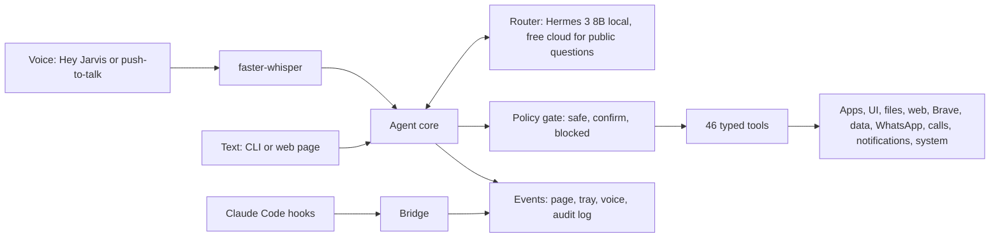

# Jarvis

[](https://github.com/PreeyasTumulu/JARVIS/actions/workflows/ci.yml)


[](LICENSE)

**A local-first voice assistant for Windows 11 that actually operates your laptop, and never acts without your yes.**

Say "Hey Jarvis" (or type), and a local LLM plans the request, calls typed tools to do it, and answers out loud. It opens apps, types and clicks in them, searches sites in your browser, reads your WhatsApp notifications, sends messages, places calls through your phone, answers data questions from free APIs, and remembers what you tell it. It can also answer Claude Code's questions for you by voice. Everything runs on your laptop by default; a free cloud model helps with hard public questions, and nothing private is ever sent to it.

> **Status:** v1.0.0 (Phase 9 of 9), waiting for hands-on testing before it is merged to `main`. See the [roadmap](docs/ROADMAP.md).

## What you can say

| | Examples |
|---|---|
| Apps and windows | "open VS Code", "switch to WhatsApp", "close the calculator", "type hello world in Notepad", "click Save in Paint", "what does Notepad say" |
| Files and projects | "find my resume", "read the README in Downloads", "open this file in VS Code", "show the logs of the postgres container" |
| Web | "search YouTube for lofi music", "look up Alan Turing on Wikipedia", "search the web for the latest Python release", "summarize https://..." |
| Data | "what's the weather tomorrow in Bangalore", "price of Reliance shares", "bitcoin in rupees", "convert 100 dollars to rupees" |
| System | "set the volume to 30", "dim the screen", "lock my computer", "take a screenshot", "set a timer for 10 minutes", "remind me to call the bank at 5" |
| People | "message Mom that I'll be late", "call Mom", "read my notifications", "anything new from Ravi" |
| Memory | "remember that my manager is Ravi", "who is my manager", "what do you remember about me" |
| Thinking | "think harder: why did the Roman empire fall in the west but not in the east" (a free cloud model) |
| Claude Code | Claude asks "Which database? one, PostgreSQL. two, SQLite." and you say "two" |

## Why it is different

- **Safety in code, not in a prompt.** Every tool has a risk floor. Sending, deleting, stopping, calling, or buying waits for your explicit yes, and the approval is bound to the exact action Jarvis showed you. Config can tighten a rule, never loosen it.
- **Private stays local.** Messages, notifications, files, the clipboard, screen text, contacts, and memories are labelled private, and the router raises an error rather than send them to a cloud model. Tests prove it with a fake cloud that records everything.
- **Content is data.** Text from web pages, files, notifications, and windows is wrapped as untrusted and can never approve anything. Secret-looking values are hidden before the model sees them.
- **Everything is audited.** Every tool call, its arguments, the decision, and the result go to a local SQLite log (`jarvis audit`).
- **Honest about Windows.** What is unreliable is written down in [RISKS.md](docs/RISKS.md), with the workaround.

## Claude Code, by voice

When Claude Code needs you, Jarvis says the question and the options aloud, shows them on its page, and passes your answer back, so you can step away from the terminal. Permission prompts work the same way with a clear "yes" or "no", and Jarvis tells you when Claude is waiting or done. If you are away from the PC, the question can follow you to your phone (an ntfy push with answer buttons, or a Twilio call). No model is involved in matching your answer.

```powershell
uv run jarvis claude-hook test       # try it
uv run jarvis claude-hook install    # turn it on for Claude Code
```

## How it works



The full design is in [ARCHITECTURE.md](docs/ARCHITECTURE.md), and every tradeoff is in [DECISIONS.md](docs/DECISIONS.md).

## Quick start

Needs Windows 11, [uv](https://docs.astral.sh/uv/), and [Ollama](https://ollama.com). A GPU with 4 GB is enough. Full details in [SETUP.md](docs/SETUP.md).

```powershell
git clone https://github.com/PreeyasTumulu/JARVIS.git
cd JARVIS
uv sync --extra voice --extra piper
ollama pull hermes3:8b
ollama create jarvis-hermes3 -f config/ollama/hermes3-8b.Modelfile
uv run jarvis setup-voice
uv run jarvis serve --wake
```

Say "Hey Jarvis" (or hold `Ctrl+Alt+J`) and try "open notepad" or "what's the weather". `Ctrl+Alt+X` or "stop" cancels. `uv run jarvis startup enable` starts it at every login in the tray. Add contacts with `uv run jarvis contacts add "Amma" "+91 98765 43210" --alias Mom`.

## Tech stack

| Area | Choice |
|---|---|
| Language | Python 3.12 with uv |
| Local model | Nous Hermes 3 8B on Ollama, native tool calling; any OpenAI-compatible model by config |
| Cloud (optional, public questions only) | Groq gpt-oss-120b, then OpenRouter's free Nemotron, both free tiers |
| Voice | openWakeWord ("hey jarvis"), Silero VAD, faster-whisper, Piper or Windows SAPI |
| Automation | Windows UI Automation (comtypes), SendInput, Playwright driving your default browser (Brave, Chrome, or Edge) |
| Interface | FastAPI and a WebSocket page, a pystray tray icon, a rich CLI |
| Storage | SQLite (local audit log, history, contacts, memories) |

## Quality

About 550 tests run in CI on Windows, including 41 end-to-end scenarios that drive the whole pipeline with Windows and the network faked; the same scenarios run against the real local model with `pytest -m llm`. Hermes 3 8B picks the right first tool for 91% of 67 benchmark commands ([benchmark](docs/benchmarks/phase9.md)).

## Documentation

| Document | Contents |
|---|---|
| [Architecture](docs/ARCHITECTURE.md) | Components, agent loop, tool system, safety model, router, voice, the bridge, storage |
| [Setup](docs/SETUP.md) | Install, keys, Windows settings, Brave, the Claude Code bridge, phone, calls |
| [Troubleshooting](docs/TROUBLESHOOTING.md) | "Hey Jarvis" does not wake it, and everything else |
| [Roadmap](docs/ROADMAP.md) | The nine phases, their tests, and what comes after 1.0 |
| [Decisions](docs/DECISIONS.md) | Every design decision, and the ones still open |
| [Risks](docs/RISKS.md) | Windows reliability, privacy, accounts |
| [Research](docs/RESEARCH.md) | Similar projects, phone calls, small models, feature ideas |
| [Demo](docs/DEMO.md) | A five-minute demo script |
| [Contributing](CONTRIBUTING.md), [Security](SECURITY.md) | How to help, how to report a problem |

## License

[MIT](LICENSE). Piper TTS is GPL-3.0 and is used only as an optional extra, never bundled ([ADR-006](docs/DECISIONS.md#adr-006-mit-license-piper-as-an-optional-extra)).
