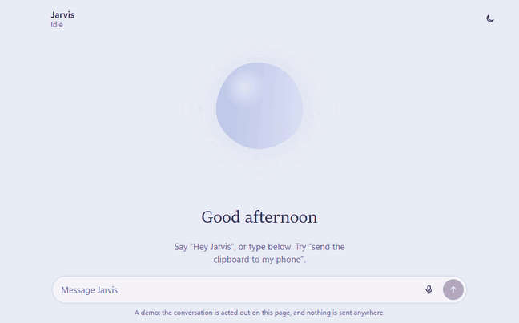
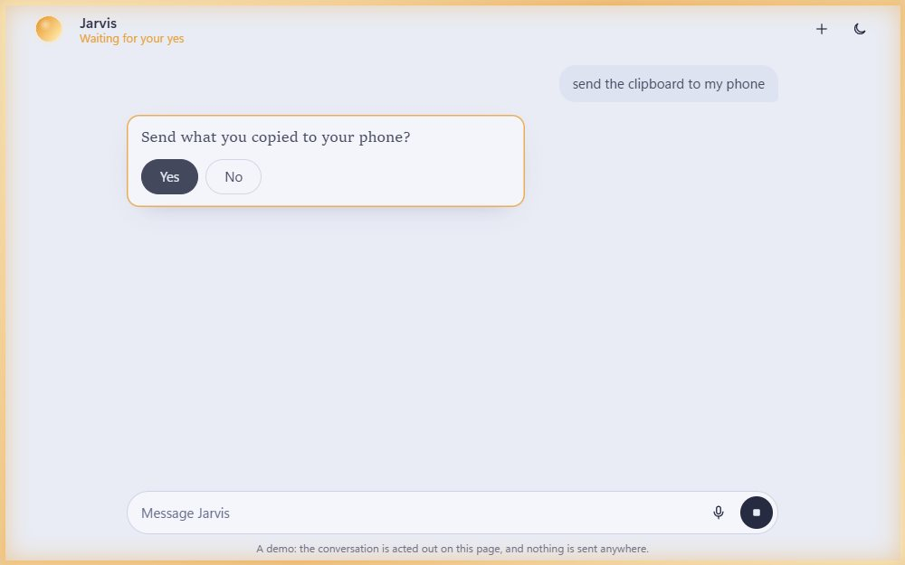
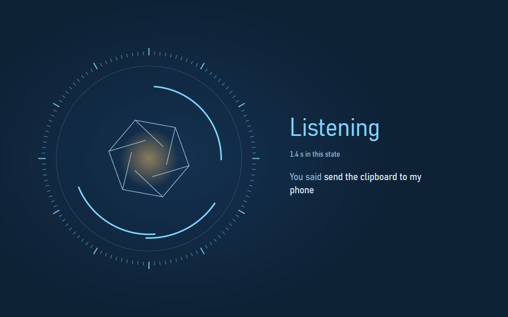
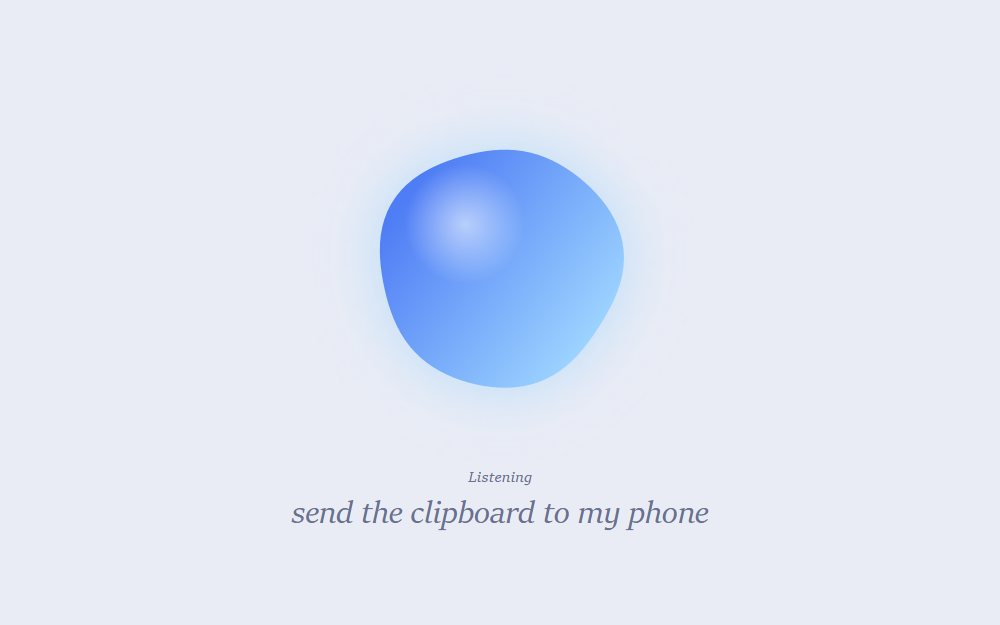
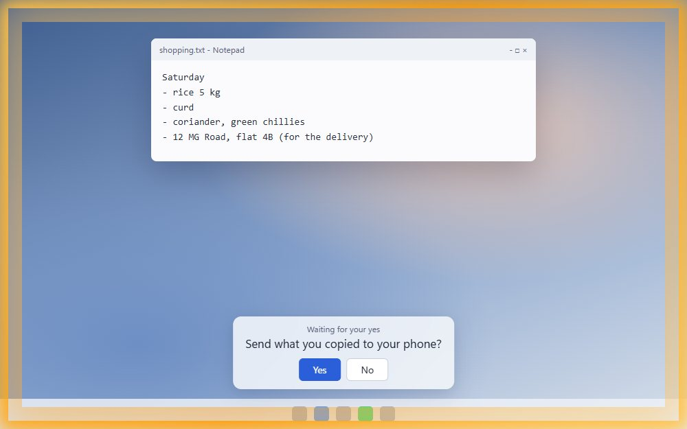
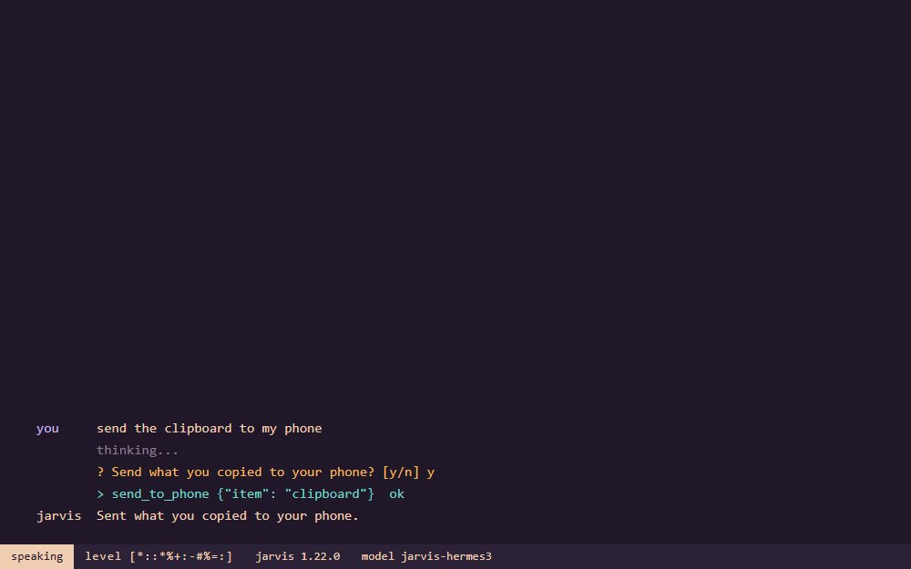
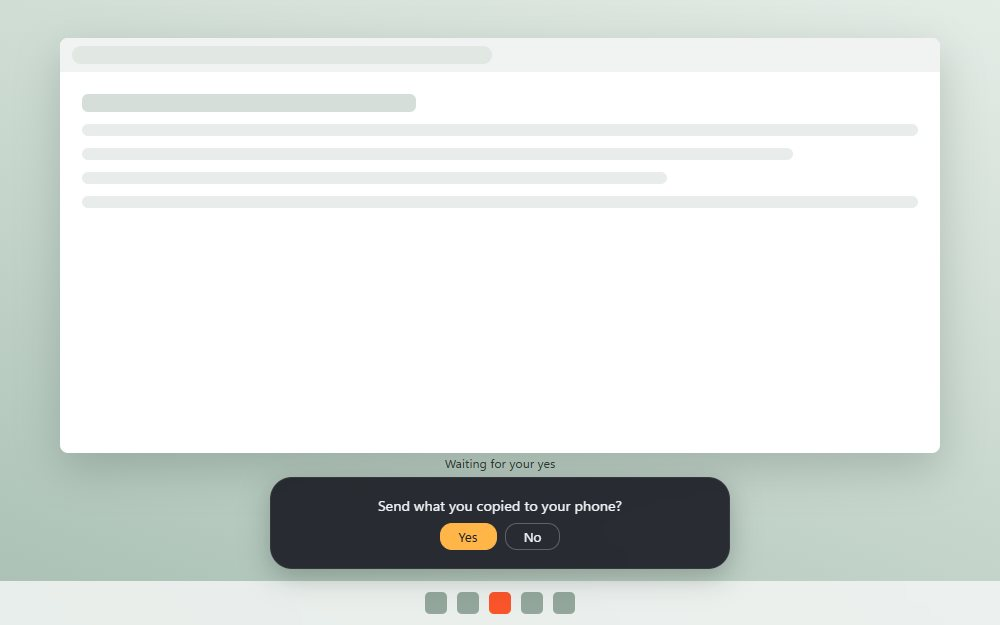
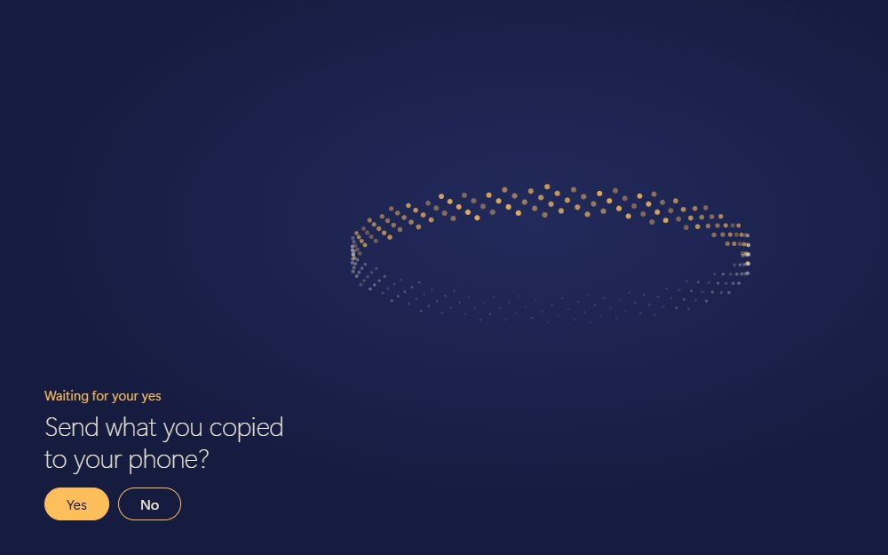
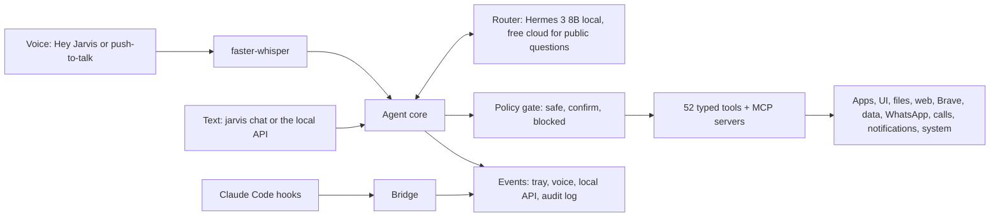

# Jarvis

[](https://github.com/PreeyasTumulu/JARVIS/actions/workflows/ci.yml)


[](LICENSE)

**A local-first voice assistant for Windows 11 that actually operates your laptop, and never acts without your yes.**



Say "Hey Jarvis" (or type), and a local LLM plans the request, calls typed tools to do it, and answers out loud. It opens apps, types and clicks in them, takes dictation into any app, controls your music, searches sites in your browser, reads your WhatsApp notifications and your email, tells you what's on your calendar, sends messages and email replies, places calls through your phone, answers data questions from free APIs, and remembers what you tell it. It can also answer Claude Code's questions for you by voice. Everything runs on your laptop by default; a free cloud model helps with hard public questions, and nothing private is ever sent to it.

> **Status:** Phases 0 to 18 are on `main`; Phases 19 to 32 (v1.22.0) are on stacked branches, hand tested and logged in [docs/HANDTESTS.md](docs/HANDTESTS.md). The chat window in the GIF above is the real interface: `jarvis ui` opens it, and it shows your typed and spoken turns live. `jarvis chat` still works in a terminal. No release is tagged past v0.3.0 yet. See the [roadmap](docs/ROADMAP.md).

## What you can say

| | Examples |
|---|---|
| Apps and windows | "open VS Code" (and how long it took), "close Spotify in 20 minutes", "switch to WhatsApp", "close the calculator", "type hello world in Notepad", "click Save in Paint", "what does Notepad say", "what's on my screen" (OCR where apps show no text) |
| Files and projects | "open my resume", "read the README in Downloads", "open this file in VS Code", "show the logs of the postgres container" |
| Notes and sheets | "note that the plumber comes on Tuesday", "what did I note yesterday", "open my notes", "add groceries and 450 to my budget sheet" (asks first), "show 18 percent of 2400 in the calculator" |
| Web | "search YouTube for lofi music", "look up Alan Turing on Wikipedia", "search the web for the latest Python release", "summarize https://..." |
| Data | "what's the weather tomorrow in Bangalore", "price of Reliance shares", "bitcoin in rupees", "convert 100 dollars to rupees" |
| Media | "play lofi beats on spotify", "pause the music", "next song", "resume", "what's playing" (instant, no model needed), in Spotify, YouTube, or any player |
| Developer | "what changed in my shop repo", "commit it" (drafts the message, asks first), "push it" (asks first), "start the shop project" (compose, waits until ready), "run redis on port 6379", "connect to my pi" (opens a terminal) |
| Dictation | hold `Ctrl+Alt+D` and speak: the text appears where your cursor is, in any app ("new line", "comma", "full stop" work) |
| System | "set the volume to 30", "dim the screen", "lock my computer", "take a screenshot", "set a timer for 10 minutes", "remind me to call the bank at 5" |
| People | "message Mom that I'll be late", "call Mom", "read my notifications", "anything new from Ravi" |
| Your phone | "find my phone" (rings it, even on silent), "send this file to my phone", "send the clipboard to my phone", "remind me on my phone at 7" (free, over your Wi-Fi with KDE Connect, or an ntfy push away from home) |
| Mail and calendar | "any new email", "read the one from Ravi", "reply that I'll send it tonight", "what's on today", "my next meeting", "am I free on Friday" |
| Focus and clipboard | "start a focus session for 50 minutes", "end my focus session", "what did I copy earlier", "put the second last thing I copied back on the clipboard" (clipboard history is off until you turn it on) |
| Memory | "remember that my manager is Ravi", "who is my boss", "what did I ask about Docker last week", "when did I check the weather", "forget what I asked about my doctor" |
| Briefing and news | "good morning" or "brief me": weather, today's calendar and reminders, unread email and messages, and how many AI stories there are; "what's new in AI" (saved with links) |
| The screen | "what's on my screen", "what does this error mean" (a local vision model; the screenshot never leaves the laptop) |
| Thinking | "think harder: why did the Roman empire fall in the west but not in the east" (a free cloud model) |
| GitHub (and any MCP server) | "any open issues on JARVIS", "read issue 12", "open an issue titled ..." (asks first), "find repos about wake words" |
| Claude Code | Claude asks "Which database? one, PostgreSQL. two, SQLite." and you say "two" |

## What it could look like

The chosen direction: the orb and the edge glow around a chat ([ui-demos/chat.html](ui-demos/chat.html), in light and dark):



It came out of six concepts, each one standalone page you can open by double-click ([ui-demos/](ui-demos/README.md)):

| Reactor | Orb | Edge glow |
|---|---|---|
|  |  |  |
| **Terminal** | **Pill** | **Constellation** |
|  |  |  |

## Why it is different

- **Safety in code, not in a prompt.** Every tool has a risk floor. Sending, deleting, stopping, calling, or buying waits for your explicit yes, and the approval is bound to the exact action Jarvis showed you. Config can tighten a rule, never loosen it.
- **Private stays local.** Messages, notifications, files, the clipboard, screen text, contacts, and memories are labelled private, and the router raises an error rather than send them to a cloud model. Tests prove it with a fake cloud that records everything.
- **Six looks to choose from.** [ui-demos/](ui-demos/README.md) has six standalone concepts for the new interface, each showing listening, thinking, speaking, waiting for your yes, running a tool, and errors. Double-click one to try it.
- **Content is data.** Text from web pages, files, notifications, and windows is wrapped as untrusted and can never approve anything. Secret-looking values are hidden before the model sees them.
- **Everything is audited.** Every tool call, its arguments, the decision, and the result go to a local SQLite log (`jarvis audit`).
- **Honest about Windows.** What is unreliable is written down in [RISKS.md](docs/RISKS.md), with the workaround.

## Claude Code, by voice

When Claude Code needs you, Jarvis says the question and the options aloud, shows them on its page, and passes your answer back, so you can step away from the terminal. Permission prompts work the same way with a clear "yes" or "no", and Jarvis tells you when Claude is waiting or done. If you are away from the PC, the question can follow you to your phone (an ntfy push with answer buttons, or a Twilio call). No model is involved in matching your answer.

```powershell
uv run jarvis claude-hook test       # try it
uv run jarvis claude-hook install    # turn it on for Claude Code
```

Jarvis is also an MCP server: Claude Code or Claude Desktop can call some of its tools (weather, sums, currency, prices, web search by default) through `jarvis mcp serve`. Only public tools can be offered, every call passes Jarvis's policy gate and audit log, and anything that needs a yes is asked on Jarvis's own voice and terminal ([setup](docs/SETUP.md)).

## How it works



The full design is in [ARCHITECTURE.md](docs/ARCHITECTURE.md), and every tradeoff is in [DECISIONS.md](docs/DECISIONS.md).

## Quick start

**Just look first:** double-click `ui-demos/chat.html` (or any page in `ui-demos/`). It runs offline in your browser, with nothing to install.

**Run Jarvis:** it needs Windows 11, [uv](https://docs.astral.sh/uv/), and [Ollama](https://ollama.com). A GPU with 4 GB is enough. Full details are in [SETUP.md](docs/SETUP.md).

```powershell
git clone https://github.com/PreeyasTumulu/JARVIS.git
cd JARVIS
powershell -ExecutionPolicy Bypass -File .\install.ps1     # checks, installs, downloads; -DryRun to only look
uv run jarvis serve --wake
uv run jarvis ui                 # the chat window
```

The installer asks before installing uv or Ollama with winget, uses the GPU for speech recognition when it finds an NVIDIA card, and never overwrites your `config/local.toml` or `.env`. The manual steps are in [SETUP.md](docs/SETUP.md).

Copy `.env.example` to `.env` only for the services you want (all optional: a free Groq key makes hard public questions better; the rest are listed there). Say "Hey Jarvis" (or hold `Ctrl+Alt+J`) and try "open notepad" or "what's the weather". No voice? `uv run jarvis chat` types instead. Hold `Ctrl+Alt+D` to dictate into the app you are typing in. `Ctrl+Alt+X` or "stop" cancels. `uv run jarvis startup enable` starts it at every login in the tray. Add contacts with `uv run jarvis contacts add "Amma" "+91 98765 43210" --alias Mom`.

## Tech stack

| Area | Choice |
|---|---|
| Language | Python 3.12 with uv |
| Local model | Nous Hermes 3 8B on Ollama, native tool calling; any OpenAI-compatible model by config |
| Cloud (optional, public questions only) | Groq gpt-oss-120b, then OpenRouter's free Nemotron, both free tiers |
| Voice | openWakeWord ("hey jarvis"), Silero VAD, faster-whisper on the GPU, Piper or Windows SAPI |
| Automation | Windows UI Automation (comtypes), SendInput, Playwright driving your default browser (Brave, Chrome, or Edge) |
| Interface | the chat window (served by Jarvis, shown in Brave's app mode), a rich CLI, a pystray tray icon, and a local FastAPI and WebSocket API |
| Storage | SQLite (local audit log, history, contacts, memories) |

## Quality

About 1,170 tests run in CI on Windows. They include 54 end-to-end scenarios that drive the whole pipeline with Windows and the network faked, and the same scenarios run against the real local model with `pytest -m llm`. Hermes 3 8B picks the right first tool for 92% of 113 benchmark commands ([benchmark](docs/benchmarks/phase29.md)). CI also checks that the repository holds no em dashes and no personal data: home folder paths, home network addresses, real-looking phone numbers, real email addresses, or API keys (`scripts/check_personal.py`).

## Documentation

| Document | Contents |
|---|---|
| [Architecture](docs/ARCHITECTURE.md) | Components, agent loop, tool system, safety model, router, voice, the bridge, storage |
| [Setup](docs/SETUP.md) | Install, keys, Windows settings, Brave, the Claude Code bridge, phone, calls |
| [Troubleshooting](docs/TROUBLESHOOTING.md) | "Hey Jarvis" does not wake it, and everything else |
| [Roadmap](docs/ROADMAP.md) | The nine phases, their tests, and what comes after 1.0 |
| [Decisions](docs/DECISIONS.md) | Every design decision, and the ones still open |
| [Risks](docs/RISKS.md) | Windows reliability, privacy, accounts |
| [Research](docs/RESEARCH.md) | Similar projects, phone calls, small models, feature ideas |
| [Demo](docs/DEMO.md) | A five-minute demo script |
| [Contributing](CONTRIBUTING.md), [Security](SECURITY.md) | How to help, how to report a problem |
| [Changelog](CHANGELOG.md) | Every version, phase by phase |

## License

[MIT](LICENSE). Piper TTS is GPL-3.0 and is used only as an optional extra, never bundled ([ADR-006](docs/DECISIONS.md#adr-006-mit-license-piper-as-an-optional-extra)).
