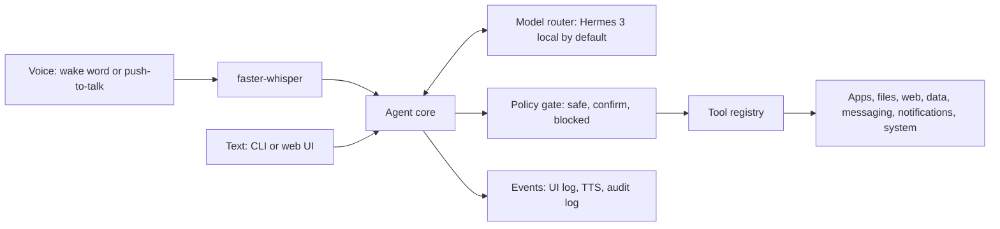

# Jarvis

A local-first, voice-controlled desktop assistant for Windows 11. Say (or type) a command, and Jarvis plans it with a local LLM, calls typed tools to operate your laptop, and answers out loud.

> **Status: Phase 0, planning complete.** No runnable code yet. Phase 1 (the skeleton) is next. See the [roadmap](docs/ROADMAP.md).

## What it will do

- Open, focus, and close any installed app by name: VS Code, Docker, Claude, WhatsApp, your browser, and more
- Find and open files inside folders you allow
- Search the web, read pages, and drive web apps with Playwright
- Answer data questions from free APIs: stocks (including NSE and BSE), weather, currency, crypto
- Read notifications aloud and send WhatsApp messages, always after you confirm
- Control the system: volume, brightness, lock, screenshot, clipboard, timers
- Work the same through a local web UI with chat, a live tool log, and confirm buttons

## Principles

1. **Local first.** The default model is Nous Hermes 3 8B on Ollama. Cloud models are optional and off by default.
2. **Private data stays local.** WhatsApp content, notifications, files, clipboard, and screen text are labelled private, and the router refuses to send them to a cloud model. This is enforced in code, not in a prompt.
3. **The model proposes, the policy decides.** Every tool has a risk level. Safe tools run, confirm tools wait for your explicit yes, blocked tools never run.
4. **Content is data, not instructions.** Text read from web pages, files, or notifications cannot approve or trigger anything.
5. **Everything is audited.** Every tool call, its arguments, the decision, and the result go to a local SQLite audit log.
6. **Honest about Windows.** Anything unreliable on Windows is documented in [RISKS.md](docs/RISKS.md), not faked.

## How it works



Full design: [docs/ARCHITECTURE.md](docs/ARCHITECTURE.md).

## Tech stack

| Area | Choice |
|---|---|
| Language | Python 3.12, managed with uv |
| Local LLM | Nous Hermes 3 8B via Ollama, native function calling |
| Model access | OpenAI-compatible client, so any compatible model works by config |
| Wake word | openWakeWord ("hey jarvis", ONNX) |
| Speech to text | faster-whisper |
| Text to speech | Piper (optional), Kokoro, or Windows SAPI |
| Backend and UI | FastAPI, WebSocket, plain HTML and JavaScript |
| Automation | pywinauto (UIA), Playwright, PyAutoGUI as last resort |
| Storage | SQLite |

## Documentation

| Document | Contents |
|---|---|
| [Architecture](docs/ARCHITECTURE.md) | Components, agent loop, tool system, safety model, router, storage, repo layout |
| [Roadmap](docs/ROADMAP.md) | The nine phases with scope, exit criteria, and test commands |
| [Setup](docs/SETUP.md) | Verified environment, install steps, API keys, Windows settings |
| [Decisions](docs/DECISIONS.md) | Design decisions and the ones still open |
| [Risks](docs/RISKS.md) | Windows reliability, hardware budget, privacy and account risks |

## Quick start

Available from Phase 1. It will look like this:

```powershell
git clone https://github.com/PreeyasTumulu/jarvis.git
cd jarvis
uv sync
ollama pull hermes3:8b
uv run jarvis chat
```

## License

[MIT](LICENSE). Piper TTS is GPL-3.0 and is used only as an optional extra, never bundled. See [ADR-006](docs/DECISIONS.md#adr-006-mit-license-piper-as-an-optional-extra).
