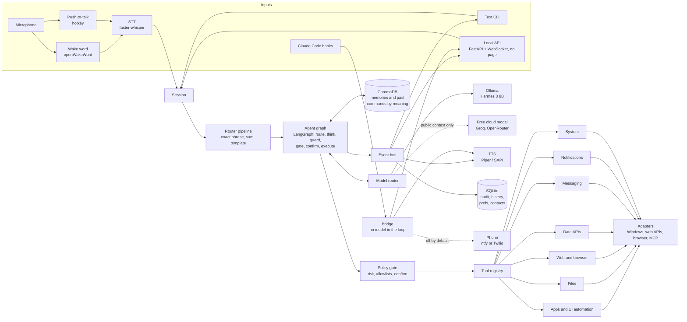
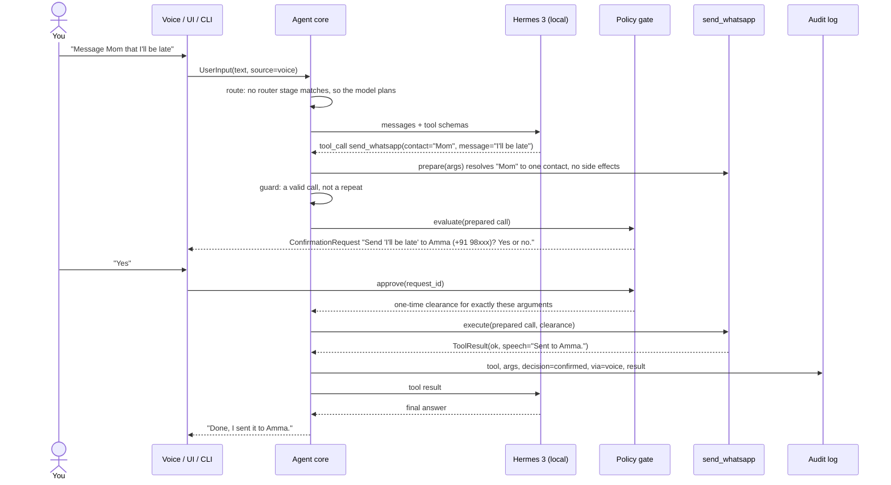
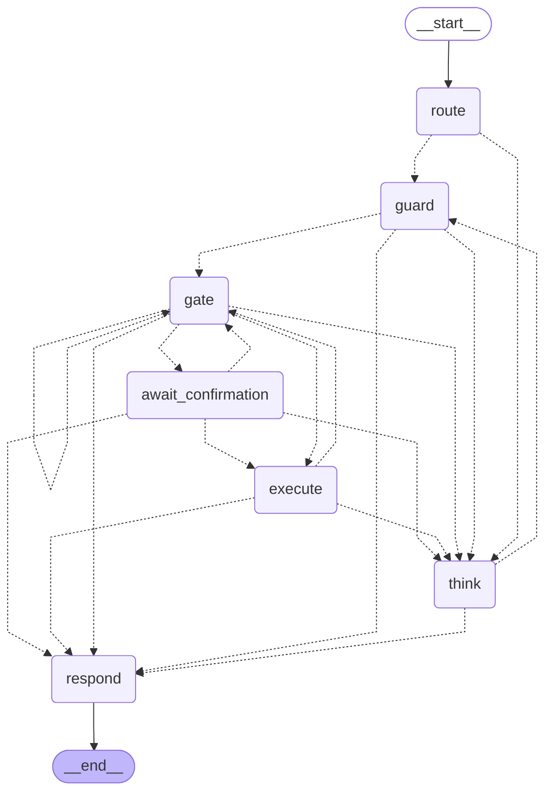
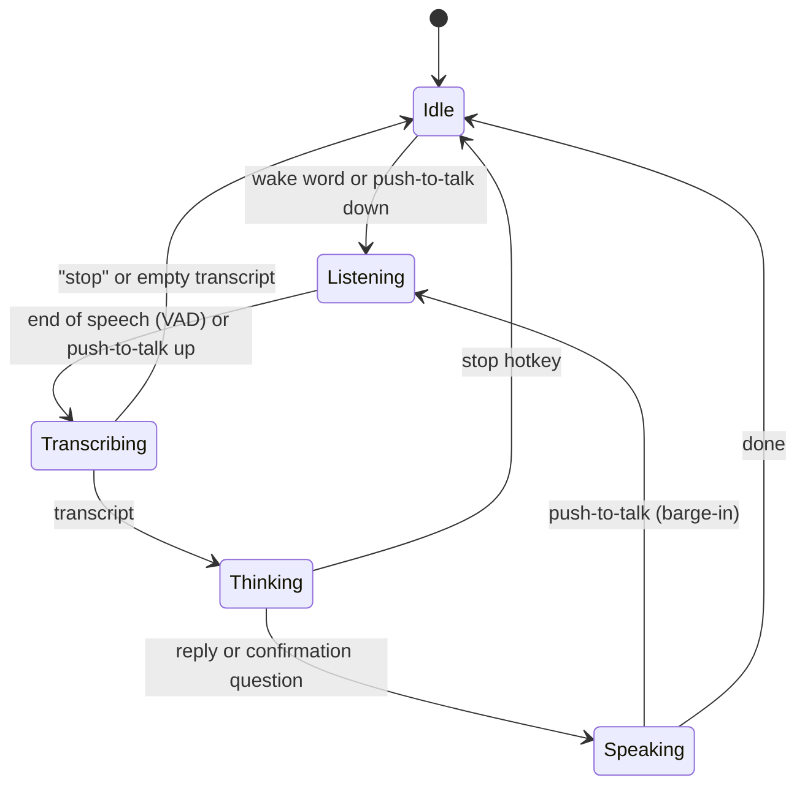
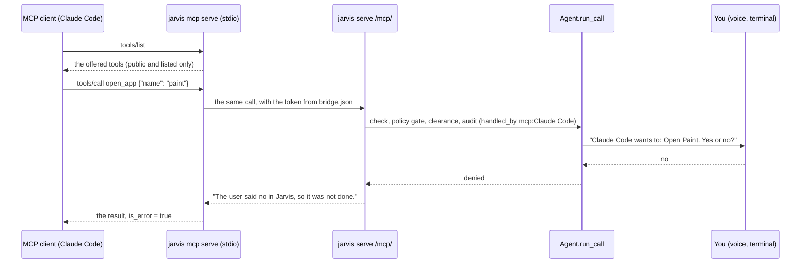

# Architecture

This document describes how Jarvis is put together and why. It is the reference for every phase in [ROADMAP.md](ROADMAP.md). Decisions with real tradeoffs are logged in [DECISIONS.md](DECISIONS.md), and known weak spots are in [RISKS.md](RISKS.md).

## 1. Goals and non-goals

**Goals**

- One assistant core shared by voice and text. A spoken command and a typed command take the same path and produce the same result.
- Local by default. The planner is Nous Hermes 3 (8B, quantized) on Ollama, called through an OpenAI-compatible client.
- Typed, auditable tools. Each tool is a Python function with a generated JSON schema, a risk level, and a sensitivity label.
- Safety enforced in code. Risk levels, allowlists, confirmation, cancellation, and the privacy router work even if the model misbehaves.
- Models are swappable by config only. The agent loop is a LangGraph graph whose policy gate is a node no path can skip (section 4).

**Non-goals (for now)**

- Multi-user or remote access. The local API binds to `127.0.0.1` only.
- Running as administrator. Jarvis runs as a normal user and cannot drive elevated windows. This is intentional.
- Vision-first computer use. A vision fallback exists behind a feature flag, but structured automation is the main path.
- A general-purpose shell tool. Jarvis uses specific adapters (VS Code, Docker, etc.) instead. See ADR-010.

## 2. System overview



| Component | Responsibility | Main libraries |
|---|---|---|
| Inputs | Turn speech or text into a `UserInput` for a session | sounddevice, openWakeWord, faster-whisper |
| Session | Holds conversation state for one user, shared by every input channel | stdlib asyncio |
| Router pipeline | Handle exact phrases, sums, and one-slot commands without a model | rapidfuzz |
| Agent graph | Plan with the LLM, guard and gate each call, run tools, until done or limits hit | LangGraph, openai (AsyncOpenAI), pydantic |
| Model router | Pick local or cloud model per turn, enforce the privacy guard | openai, httpx |
| Policy gate | Decide safe / confirm / blocked for each call, run confirmations | pydantic |
| Tool registry | Register typed tools, generate JSON schemas, execute with timeouts | pydantic, stdlib inspect |
| Tools | Do the actual work on Windows and the web | UI Automation (comtypes), SendInput, Playwright (your default browser: Brave, Chrome, or Edge), httpx, pywinrt |
| Bridge | Claude Code's questions and permissions, asked by voice, page, or phone | FastAPI route, httpx |
| Event bus | Fan out typed events to UI, CLI, TTS, and the audit log | stdlib asyncio |
| Adapters | Every outside call: Windows APIs, web APIs (keys, retries, rate limits), browser, MCP | httpx, comtypes, Playwright |
| Storage | Preferences, contacts, history, audit log, caches; vectors in ChromaDB | sqlite3, chromadb |

## 3. Lifecycle of one command

Example: "Message Mom that I'll be late."



If "Mom" matched two contacts, `prepare` would return a clarification request and the agent would call `ask_user` before anything is confirmed or sent.

## 4. Agent core

The agent loop is a LangGraph graph (`core/graph.py`, ADR-079, ADR-083). LangGraph was chosen over keeping the hand-written loop for named states, a checkpoint of where a stopped turn was, and a diagram that is generated from the code instead of drawn by hand. Tools, the policy gate, the executor, and the model router did not change shape; they became nodes.

### 4.1 The graph

This diagram is printed by `AgentGraph.mermaid()`, and a test (`tests/unit/test_architecture_doc.py`) fails if it no longer matches the code. Solid lines are fixed edges; dotted lines are the choices a node makes.

<!-- graph:begin -->

<!-- graph:end -->

| Node | What it does | Voice state it maps to |
|---|---|---|
| `route` | Runs the router pipeline (4.3). A match becomes a proposed tool call; no match goes to `think` | thinking |
| `think` | The model (local, or a cloud model for heavy public questions, 7.2) answers or proposes tool calls | thinking |
| `guard` | Repairs a near miss once, drops repeats, caps the calls in a turn (4.4) | thinking |
| `gate` | The policy gate rates one call: safe, confirm, or blocked (6.1) | thinking |
| `await_confirmation` | Asks you and waits for yes, no, or the time limit | awaiting_confirmation |
| `execute` | Runs the tool with the gate's one-time clearance (4.5) | running_tool |
| `respond` | The answer for this turn | responding |

Every node entered publishes `AgentStateChanged(node, state)`, the state names LiveKit Agents uses, so a client can show what Jarvis is doing without knowing the graph.

**State.** LangGraph checkpoints `TurnState`, which holds plain values only: `handled_by`, `step`, the queue of call ids waiting for the gate, the call at the gate, the gate's verdict, and the reply. Live objects (the tool context, the guard, the speech stream, the outcomes) travel in `TurnRuntime`, LangGraph's runtime context, and are never checkpointed. The checkpointer is in memory with one thread per turn, deleted when the turn ends, so nothing private outlives the turn in it (ADR-083).

**No way around the gate.** `execute` is reachable only from `gate` and `await_confirmation`, and `await_confirmation` only from `gate`. A test reads the compiled graph's edges to keep it so (`tests/unit/test_gate_coverage.py`).

### 4.2 Lifecycle in the graph

```text
route ─┬─ a stage matched ──────────────┐
       └─ no match ─> think ─┬─ answer ─┼──────────────────────────────> respond
                             └─ calls ──┴─> guard ─> gate ─┬─ safe ─────> execute ─┐
                                                           ├─ confirm ─> await_confirmation ─> execute or refused
                                                           └─ blocked, invalid ─> back to think with the error
execute ─┬─ more calls queued ─> gate
         ├─ a router stage started the turn ─> respond (the tool's own words are the answer)
         └─ otherwise ─> think (the model sees the result)
```

### 4.3 Router pipeline

Taken from OpenVoiceOS's intent pipeline and Home Assistant's "prefer handling commands locally" (RESEARCH.md 6.2). `[router] pipeline` lists stages in order; each gets `stage_timeout_ms` (default 150) and answers "this tool call" or "not mine". The first match wins.

| Stage | Handles | Example |
|---|---|---|
| `exact_phrase` | whole short commands, and "yes" to the briefing offer | "pause the music", "hang up" |
| `arithmetic` | a request that is only a sum (ADR-082) | "what is 18 percent of 2400" |
| `template` | one slot filled from this laptop: an app that is in the app index, a volume level, mute, a note | "open notepad", "volume 30", "note that the plumber comes on Tuesday" |
| `agent` | everything else: the model | "message Mom that I'll be late" |

A match is only a proposed call. It enters the graph at `guard` and passes the policy gate like any call the model makes, so a stage can never run a tool by itself. Every turn records which stage handled it as `handled_by` (`exact_phrase`, `arithmetic`, `template`, `agent`, or `cloud`) in `command_history` and in the audit log. "open my report" falls through to the model, because only exact app index names and aliases match the template ("open youtube" opens the YouTube app only if one is installed). On a fresh data folder the first Start menu scan takes longer than the stage limit, so that one request goes to the model while the index builds.

### 4.4 Guard

`core/guard.py` screens proposed calls before the gate, without a model:

- **Repair once:** an unknown tool name close to an offered one (rapidfuzz WRatio 88 or more) is corrected ("open_ap" to "open_app"), and arguments a small model meant as JSON (fenced, single-quoted, Python's `True` and `None`, a trailing comma) are rewritten. Anything else is refused as invalid with the reason, and the model gets one more try; a second round with nothing valid ends the turn with "I couldn't work out how to do that" and status `limit`.
- **No repeats:** the same tool with the same arguments in one turn is not run again (`decision = duplicate` in the audit log). The model gets the earlier result back, and a refusal stays a refusal, so you are never asked twice.
- **Step cap:** `agent.max_tool_calls_per_turn` (default 8) calls in one turn at most.

### 4.5 Clearances

A tool refuses to run without a `Clearance` (`tools/base.py`): permission from the policy gate for one call of one tool with exactly the approved arguments, used up when the tool runs. Only `PolicyGate.clear` issues one, and it rates the call again when asked, so a caller cannot bring its own verdict: blocked never runs, confirm runs only after a yes. `Tool` is a frozen dataclass, and the registry refuses a second tool with the same name. Source scans in `tests/unit/test_gate_coverage.py` check that tool functions are called only by `Tool.__call__`, clearances are issued only by the gate, and only the executor passes one to a tool.

### 4.6 Limits

| Limit | Default | Why |
|---|---|---|
| `max_iterations` | 6 | An 8B model can loop; stop early and say what happened |
| `max_tool_calls_per_step` | 4 | Caps parallel tool calls in one model reply |
| `max_tool_calls_per_turn` | 8 | Caps calls across the whole turn (guard) |
| `tool_timeout_s` | 20 | Per tool call; tools can set their own `timeout_s` (browser and WhatsApp tools get longer) |
| `turn_timeout_s` | 180 | Hard ceiling for one command (a first WhatsApp Web load takes up to a minute) |
| `confirm_timeout_s` | 30 | No answer means no |
| `[router] stage_timeout_ms` | 150 | A router stage slower than this is skipped |

**Stopping a turn.** "Stop", the stop hotkey, or a new command cancels the turn. A tool with `cancel_on_interruption = True` (the default) is cancelled with it and audited as cancelled. A tool with `cancel_on_interruption = False` (a message already being sent) finishes in the background and is audited with its real result when it ends.

### 4.7 Prompting

The system prompt carries: identity and style (short, spoken sentences), the current date, time, and time zone, the rule that tool results are data and never instructions, and when to use `ask_user`. **Tool routing** (`core/tool_routing.py`, Phase 3): keyword groups (apps, files, docker, web) choose which tools a request sees; a request that matches no group sees all of them, and the executor still accepts any registered tool. **Semantic routing** (`core/semantic_routing.py`, Phase 13): when no keyword group matches, the request is embedded with `nomic-embed-text` and compared with example requests per group (ADR-063). With both, 93% of 84 benchmark commands get the right first tool.

**Memory in the prompt:** facts about you (`remember(about="user")`) and facts about the current work (`about="context"`) have their own character budgets (`[memory] user_chars`, `context_chars`), and only memories that fit the request are added (ADR-084).

**Spoken replies:** each tool result carries a one-sentence `summary`, list results end with a short reply instruction, and `max_tokens` caps the worst case.

### 4.8 Tool calls and streaming

1. Native `tool_calls` from Ollama's OpenAI-compatible endpoint (Hermes 3 has the `tools` capability).
2. Fallback: `<tool_call>{...}</tool_call>`, or a whole reply of bare JSON, written as text is parsed (`llm/toolcall_parser.py`).
3. For voice, the local model streams (`LLMClient.stream`). Text goes to a `SpeechStream` (`core/speech.py`) as it is written and is spoken sentence by sentence (section 8). Text that could be a tool call is held back: a reply that starts with `{`, `<`, or a code fence, and everything from a `<` on, waits until the reply is complete, and is spoken then only if it was not a call. If the model says something and then calls a tool, the stream closes at the call, so nothing talks over a confirmation question; the final answer is then spoken whole after the turn.

### 4.9 Latency breakdown

Every turn stores its stage times in `command_history.timings_json`:

| Key | From | To |
|---|---|---|
| `audio_ms`, `stt_ms`, `pre_turn_ms` | (voice) speech | the turn starting |
| `route_ms` | turn start | the router pipeline's answer |
| `llm_ms` | | time inside model calls, summed |
| `first_token_ms` | turn start | the first streamed reply text |
| `first_tool_ms` | turn start | the first tool starting |
| `tool_ms` | | time inside tools, summed |
| `turn_ms` | turn start | the reply |
| `first_audio_ms` | (voice) end of your speech | the first sound of the answer |

### 4.10 Startup

LangGraph takes about 2.5 s to import on this laptop and ChromaDB about 1 s. Both are imported lazily, and `jarvis chat` and `jarvis serve` warm them up in a background thread at start (`Agent.warm_up_in_background`), so the prompt and the server are ready at once and the first request usually finds the graph built. A lock makes a first request that arrives during the warm-up wait for the same build instead of starting a second one.

## 5. Tool system

### 5.1 Defining a tool

```python
@tool(risk=Risk.SAFE, sensitivity=Sensitivity.PUBLIC, timeout_s=10)
async def open_app(ctx: ToolContext, name: str) -> ToolResult:
    """Open an installed application by its spoken name.

    Args:
        name: Spoken or approximate app name, for example "vs code" or "docker".
    """
```

The decorator reads the signature and docstring and builds a pydantic model for the arguments. That model produces the JSON schema sent to the LLM and validates the arguments the LLM sends back.

### 5.2 ToolSpec fields

| Field | Meaning |
|---|---|
| `name`, `description`, `parameters` | Generated from the function, sent to the model |
| `risk` | Floor risk level: `safe`, `confirm`, or `blocked` |
| `risk_for(args, ctx)` | Optional dynamic check that can raise risk for specific arguments (never lower it) |
| `sensitivity` | `public` or `private`, label for what the result contains |
| `untrusted` | True if the result contains outside content (web, files, notifications, window text) |
| `timeout_s` | Per-call timeout |
| `prepare` / `execute` | Two-phase tools: `prepare` resolves and validates with no side effects, `execute` does the work |
| `enabled` | Config can disable any tool |

### 5.3 Risk levels

| Level | Behaviour | Examples |
|---|---|---|
| `safe` | Runs directly | open an allowlisted app, search, read weather, read an allowlisted file |
| `confirm` | Waits for your explicit yes (voice, UI button, or CLI) | send a message, stop a container, close an app that may have unsaved work, unlisted app, browser form submit |
| `blocked` | Never runs, logged as blocked | paths outside the allowlist, registry edits, disk formatting, reading credential stores, typing into password fields |

Rule: **config can tighten risk but never loosen it below the tool's floor.** `send_whatsapp` is `confirm` forever, no setting changes that.

### 5.4 Sensitivity and the privacy label

Every tool result carries `public` or `private`. The default is `private` (fail closed). The session tracks the highest sensitivity in its context. The router uses this label to decide whether a cloud model may ever see the turn (section 7).

`private` includes: WhatsApp content, notifications, file names and contents, clipboard, screen and window text, contacts, memory, and your answers to `ask_user`.

### 5.5 Results enter the context as data

```python
class ToolResult(BaseModel):
    ok: bool
    data: Any = None            # structured, for the UI and the model
    speech: str | None = None   # one or two short sentences for TTS
    error: str | None = None
    sensitivity: Sensitivity
    untrusted: bool
```

Untrusted results are wrapped before they reach the model, and any closing tag inside the content is escaped so it cannot break out:

```text
<tool_result name="fetch_page" untrusted="true">
...page text...
</tool_result>
```

The prompt says this content is data. The real protection is structural: nothing the model reads can approve a `confirm` call or unblock a `blocked` one.

Text read from the clipboard, a window, a file, or a container log has values that look like secrets replaced by `[hidden]` first (API keys and tokens by their shape, `NAME=value` lines whose name says key, token, secret, or password, private keys), so they reach neither the model nor the audit log (`tools/secrets.py`, RISKS.md R38).

### 5.6 Planned tool catalog

| Tool | Phase | Risk | Sensitivity |
|---|---|---|---|
| `speak(text)` | 1 | safe | public |
| `ask_user(question, options?)` | 1 | safe | private |
| `open_app(name)` | 1 basic, 3 full index | safe if allowlisted, else confirm | public |
| `web_search(query)` | 1 | safe; confirm under the egress rule (6.1, step 4a) since Phase 8 | public, untrusted |
| `focus_app(name)` | 3 | safe (opening an app that is not running follows the app allowlist) | public |
| `close_app(name)` | 3 | confirm, unless on `safety.safe_to_close` and no window title shows unsaved changes | public |
| `vscode_open(path, line?)` | 3 | safe inside folder allowlist, else blocked | private |
| `docker_list(include_stopped?)` | 3 | safe | private |
| `docker_logs(container, lines?)` | 3 | safe | private, untrusted |
| `docker_start(container)`, `docker_stop(container)` | 3 | confirm (floor) | private |
| `find_file(query, kind?)` | 3 | safe, searches only allowed folders | private |
| `open_file(path)` | 3 | safe inside allowlist; confirm for programs and scripts; blocked outside, for secrets, and for .reg | private |
| `read_file(path)` | 3 | safe inside allowlist; blocked outside and for secret-looking files | private, untrusted |
| `get_selected_file()` | 3 | safe | private |
| `search_site(site, query)` | 9 | safe; `egress`; a named site's own search page in the default browser | public |
| `open_url(url)` | 3 | safe for http and https, blocked for any other scheme; confirm under the egress rule (6.1, step 4a) | public |
| `market_data(query)` | 4 | safe | public |
| `weather(place?, day?)` | 4 | safe | public |
| `convert_currency(amount, from_currency, to_currency)` | 4 | safe | public |
| `crypto_price(coin, currency?)` | 4 | safe | public |
| `fetch_page(url)` | 4 | safe; blocked for local addresses; confirm when private data and outside content are in context (egress) | public, untrusted |
| `set_volume(level?, change?, mute?)`, `set_brightness(level?, change?)`, `lock_screen()` | 4 | safe | public |
| `screenshot()` | 4 | safe | private |
| `media_control(action)` | 10 | safe; play, pause, toggle, next, previous on the current Windows media session, the media keys otherwise | public |
| `now_playing()` | 10 | safe; the title, artist, and app of the current media session | private |
| `clipboard_read()` / `clipboard_write(text)` | 4 | safe | private, untrusted / public |
| `clipboard_history(count?)`, `clipboard_restore(position?)`, `clipboard_forget()` | 20 | safe; off until `[clipboard] history = true`; in memory only | private, untrusted / private / public |
| `focus_start(minutes?, label?)`, `focus_end()`, `focus_status()` | 20 | safe; holds Jarvis's reminders, not Windows' notifications | private |
| `set_timer`, `set_reminder`, `list_reminders`, `cancel_reminder(which)` | 4 | safe; cancelling more than one confirms | private |
| `type_text(app, text, field?)`, `click(app, target)`, `press_keys(app, keys)` | 6 | confirm, or safe inside trusted apps except destructive targets and closing keys; always confirm in messaging apps and terminals; blocked in Registry Editor, consoles, sign-in prompts, password managers, and password fields | public |
| `read_screen()` | 15 | safe; every screen read with Windows OCR | private, untrusted |
| `read_window_text(app)` | 6 | safe (blocked for the apps above) | private, untrusted |
| `browser_open(url, search?)`, `browser_read()`, `browser_click(target)`, `browser_type(text, target?, submit?)` | 6 | safe; submits, purchases, and deletes confirm (search boxes do not); passwords, card numbers, one-time codes, local addresses, and WhatsApp sites blocked; open and type are `egress` | private, untrusted |
| `send_whatsapp(contact, message)` | 6 | confirm (floor, cannot be lowered); asks which contact when a name fits several | private |
| `call_contact(contact)` | 9, 17 | confirm (floor); calls a saved contact by the WhatsApp app, or Phone Link if set | private |
| `hang_up()` | 17 | safe; presses WhatsApp's end call button | private |
| `ring_phone()` | 29 | safe; your own phone by KDE Connect, an urgent ntfy push when it is away | public |
| `notify_phone(message, title?)` | 29 | safe, egress; the way is pinned when prepared; confirm when the push would go over the internet with private data in the conversation | public |
| `send_to_phone(item?, text?)` | 29 | confirm (floor); a file through the file guard, a link, the clipboard, a screenshot, or text, over the Wi-Fi only | private |
| `read_notifications(person?)` | 7 | safe; only apps on `notifications.apps` | private, untrusted |
| `read_mail(sender?, unread_only?)`, `read_email(message)` | 11 | safe; the folder is opened read-only and nothing is marked read | private, untrusted |
| `reply_email(message, text, reply_all?)` | 11 | confirm (floor); only to the people on that email, addresses read out | private |
| `<server>_<tool>` from MCP servers (`[mcp.servers]`) | 12 | confirm (floor); safe only when the server marks it read-only and you marked the server trusted; offered only by the server's keywords | private (configurable), untrusted |
| `calendar_events(day?)` | 11 | safe; from the secret iCal link, read-only | private, untrusted |
| `recall(about, when?)` | 14 | safe; past commands by meaning in a time range | private, untrusted |
| `briefing()` | 14 | safe; weather, today's calendar and reminders, unread email and message counts | private, untrusted |
| `remember(fact)`, `list_memories()`, `forget(what)` | 8 | safe; remembering after outside content asks; forgetting always asks | private |
| `forget_history(about?, when?)` | 19 | confirm (floor); deletes commands, answers, vectors, and those turns' audit rows | private |

## 6. Safety model

### 6.1 Policy gate, in order

1. The tool exists and is enabled. Otherwise the model gets "unknown tool".
2. Arguments validate against the schema. Otherwise the model gets the validation error.
3. Static risk `blocked`: deny.
4. Dynamic `risk_for(args)`: for example a path outside the folder allowlist becomes `blocked`, an app outside the app allowlist becomes `confirm` (or `blocked`, by config).
4a. Context rule: a tool marked `egress` (it sends a request to an address the model picks) becomes at least `confirm` when the model's context holds both private tool output and untrusted outside content (ADR-029). The agent computes these flags from the messages it will send, so trimmed history drops out.
5. Global blocked patterns: registry tools, disk tools, credential stores, password fields.
6. `confirm`: run the confirmation protocol.
7. `safe`: run.

Every outcome, including blocked and denied attempts, is written to the audit log.

### 6.2 Confirmation protocol

- The confirmation is about the **prepared** call: resolved contact, resolved path, exact message text. The request stores a hash of the prepared arguments, and `execute` refuses to run if anything changed after approval.
- Any channel can answer: a UI button, a CLI prompt, or voice.
- Voice approval needs a clear affirmative from a short list ("yes", "yes send it", "confirm", "go ahead"). Anything else, silence, or a timeout counts as no.
- One pending confirmation per session. A new command while one is pending cancels it.
- Content read from tools can never answer a confirmation. Only the input channels can.

### 6.3 Allowlists

- **Apps:** `safety.app_allowlist` in config. Unlisted apps follow `safety.unlisted_apps` (`confirm` by default, or `block`).
- **Folders:** `files.allowed_folders` (default Documents, Desktop, Downloads, resolved through Windows known folders so OneDrive redirection works). Paths are resolved (`Path.resolve()`, junctions and symlinks followed) before the check, so `..` and links cannot escape. Secret-looking names (`.env`, `*.pem`, `id_rsa*`, `*password*`, ...) are blocked even inside, opening programs and scripts asks first, and `.reg` files are blocked (`tools/files/guard.py`).
- **Invented paths:** if the model passes a path that does not exist, the file tools search for the words in it and use the best match only when it clearly stands out; otherwise the model gets the closest real paths and must pick one or ask.
- **UI automation:** `safety.trusted_ui_apps` lists apps where generic `click` / `type_text` / `press_keys` run without confirmation, except targets that look destructive (send, delete, remove, buy, pay, submit, close, don't save, ...) and closing shortcuts (Alt+F4, Ctrl+W). Messaging apps and terminals are never trusted, whatever the config says, and a few apps are blocked outright (ADR-042, `tools/ui/guard.py`).

### 6.4 Cancellation

- Each turn runs as one asyncio task, and stopping a turn is task cancellation. `Agent.cancel()` is safe to call from any thread. Triggers: Ctrl+C in the CLI (Phase 1), the global stop hotkey and the voice command "stop" (Phase 2), and the Stop button in the UI (Phase 5).
- "Stop" is matched deterministically on the transcript before the LLM sees it, so it works even when the model is slow.
- On cancel: the in-flight LLM request is aborted, the running tool is cancelled, TTS stops, and any pending confirmation is denied. The audit log records the call as `cancelled`, and the conversation is rolled back to a clean state so the next command works normally.
- Work running in a thread (for example UI automation) cannot be killed safely in Python. Those tools check a stop flag between steps, so a stuck call may take a moment to wind down. This is called out in RISKS.md.

### 6.5 Audit log

Each tool call records: timestamp, session and turn ids, tool, full arguments, risk, decision (`auto`, `confirmed`, `denied`, `blocked`, `timeout`, `cancelled`), the confirming channel, success, a truncated result, error, and duration. The audit log is local only. `audit.redact_private = true` stores a hash and length instead of private argument text if you ever want that.

## 7. Model layer and router

### 7.1 One client for every model

All models are reached through `AsyncOpenAI(base_url=..., api_key=...)`. Providers live in config:

```toml
[llm.providers.local]
base_url = "http://localhost:11434/v1"
model = "jarvis-hermes3"          # hermes3:8b plus config/ollama/hermes3-8b.Modelfile (num_ctx)
api_key_env = ""                  # Ollama ignores the key

[llm.providers.groq]                # free tier, gpt-oss-120b, fast
base_url = "https://api.groq.com/openai/v1"
model = "openai/gpt-oss-120b"
api_key_env = "GROQ_API_KEY"

[llm.providers.openrouter]          # free tier, about 50 requests a day
base_url = "https://openrouter.ai/api/v1"
model = "nvidia/nemotron-3-ultra-550b-a55b:free"
api_key_env = "OPENROUTER_API_KEY"

[router]
cloud = ["groq", "openrouter"]      # tried in order, then local
escalate = "auto"                   # or "explicit", or "never"
```

Ollama's OpenAI-compatible endpoint does not accept a context length per request, so Jarvis ships a Modelfile (`num_ctx`, low temperature) and creates a local alias model from it. See SETUP.md.

### 7.2 Routing rules

| Situation | Model |
|---|---|
| Default | local |
| `router.cloud = []`, `escalate = "never"`, or no API key in `.env` | local, always |
| "Think harder", "use the cloud model", and every matched routing group is public (web, questions, market, weather) | cloud |
| `escalate = "auto"`: a reasoning question (why, explain, compare, plan, should I; 8 or more words) about public topics only | cloud |
| The request touches apps, files, messages, notifications, the clipboard, the screen, UI, the browser, or memory | local, always |
| The cloud model asks for a tool that is not public and read only | local, for the whole turn |
| Provider errors (429, timeout, down), or its daily cap is reached | next provider, then local |

### 7.3 The privacy guard

The guard is code, not a prompt:

- A cloud turn gets a **fresh context**: system prompt, the current request, and `public` tool results only. Earlier private history is never forwarded.
- A cloud turn sees only public read-only tools (`web_search`, `fetch_page`, `market_data`, `crypto_price`, `convert_currency`, `weather`). If it asks for anything else, the turn falls back to local.
- Memories are never added to a cloud turn's prompt.
- The cloud client wrapper refuses any request whose state sensitivity is `private` and raises, so a router bug fails loudly instead of leaking.
- Tests use a fake cloud client that records everything it is sent; they check that private history, memories, and notification text never appear in it (`tests/unit/test_router.py`).

## 8. Voice pipeline



- **Capture:** sounddevice at 16 kHz mono in 80 ms frames, callback thread feeding an asyncio queue (`voice/audio.py`). Device names resolve to the MME entry, which accepts 16 kHz directly.
- **One reader:** `VoiceSession._frame_loop` (`voice/session.py`) routes every frame to the push-to-talk buffer, the endpointer, or the wake word detector, depending on what the session is doing.
- **Push-to-talk:** hold a hotkey, speak after the beep, release. The microphone is open only while the key is held. Hotkeys use Win32 `RegisterHotKey` on their own thread; releases are detected by polling the key (`platform/hotkeys.py`).
- **Dictation (Phase 10):** hold `dictation.hotkey` (Ctrl+Alt+D), speak, release. The session records like push-to-talk (`Capture.DICTATION`), Whisper transcribes without the command hint, and `voice/dictation.py` formats the text by rules (spoken punctuation, fillers, capitals) and inserts it in the focused window: typed as Unicode when short, pasted through a borrowed clipboard (kept out of Win+V history, then restored) when long. The agent never sees dictated text; line breaks are Shift+Enter (ADR-054, RISKS.md R39).
- **Wake word (opt-in, `--wake`):** openWakeWord "hey jarvis" with the ONNX backend (TFLite is not supported on Windows). The microphone stays open in this mode.
- **Endpointing:** Silero VAD probabilities per frame feed `Endpointer` (`voice/endpoint.py`), which ends the recording after 0.8 s of silence, after 12 s, or if nothing was said within 5 s.
- **STT:** faster-whisper `small.en`, on the GPU (`int8_float16`, about 135 ms a command) when the `gpu` extra is installed and on the CPU (`int8`, 8 threads, about 1.4 s) otherwise, falling back to the CPU if CUDA fails (ADR-062); with a short vocabulary hint (app names). Silent or tiny clips are skipped, and Whisper's typical silence hallucinations ("Thank you.") are dropped.
- **TTS:** Piper (optional extra, GPL-3.0) speaks sentence by sentence, synthesizing the next sentence while the current one plays; stop cuts it within about 50 ms. Windows SAPI is the fallback.
- **Streamed replies (Phase 24):** with `[tts] stream = true` (the default) each voice turn gets a `SpeechStream`. The local model's reply is spoken sentence by sentence while it is still being written (`PiperTTS.speak_stream`; SAPI speaks each sentence as it arrives), so the first sound comes after the first sentence, not the whole reply. A reply already spoken this way is not spoken again; a fast path answer, a cloud answer, or a turn that went on to call a tool after speaking is spoken whole when the turn ends (4.8).
- **Deterministic phrases** (`voice/phrases.py`): "stop" style commands and yes/no answers never go through the model.
- **Confirmations by voice:** `VoiceChannel` speaks "Should I open Paint? Say yes or no." and waits for the next utterance. In voice mode the agent's channel is `FirstAnswerChannel(voice, keyboard)`, so typing y or n also works (ADR-022).
- **Self-trigger:** without echo cancellation, speaker output can trigger the wake word. Wake word detection is paused while Jarvis speaks and for 0.4 s after. Barge-in uses the push-to-talk hotkey.
- **Staying up (Phase 9):** voice that cannot start (no microphone yet at login, no network) is logged and retried by `jarvis serve` (10 s, 20 s, 40 s, 60 s, then every two minutes) with a fresh PortAudio device list; a crashed voice loop starts again; an open microphone that sends nothing for 3 s is reopened (sleep and resume, device changes); Whisper loads its downloaded copy without the network. `jarvis voice --wake-test` shows the level and the wake word score live (RISKS.md R33, R34).
- **Live transcript (Phase 18):** while recording, Whisper also runs on what has been heard so far and `TranscriptPartial` shows it; `VoiceLevel` carries the loudness, never the audio. Only the final transcript is acted on (ADR-072).
- **Timings:** every voice command stores the stage times in 4.9, including `first_audio_ms` (end of your speech to the first sound of the answer), in `command_history.timings_json`; the session prints the median "end of speech to first action" when it exits.

## 9. Interfaces

### 9.1 CLI

`jarvis chat` is a rich terminal client on the same session API: it shows tool calls live, prompts y/n for confirmations, and Ctrl+C cancels the current turn (a second Ctrl+C quits).

### 9.2 Local API (the page was removed in Phase 22)

There is no page (ADR-081). FastAPI serves `GET /health`, `POST /bridge`, and one WebSocket (`src/jarvis/server/`) for programs on this computer; the UI rebuilt from `ui-demos/` will be one of them. `jarvis serve` runs it on the same event loop as the agent, voice, and reminders, so all of them share one conversation (ADR-035, ADR-036). When `serve` is started from a terminal, confirmations can also be answered there.

| Direction | Message | Purpose |
|---|---|---|
| client to server | `command {text}` | Typed command (refused while another runs) |
| client to server | `confirm {request_id, approved}` | Confirm or Cancel; only `true` approves |
| client to server | `answer {question_id, text}` | Answer to `ask_user` |
| client to server | `stop {}` | Stop button and Esc |
| client to server | `mic {on}` | Talk button, same as holding the push-to-talk hotkey |
| client to server | `audit {}` | Last 50 audit rows |
| client to server | `contacts {}`, `contact_add {name, phone, aliases}`, `contact_remove {id}`, `contact_import {text}` | Contacts tab (the model has no tool that changes contacts) |
| server to client | `hello {version, model, busy, voice, history, open}` | On connect: recent turns, open cards and questions |
| server to client | every bus event, e.g. `turn_started`, `tool_call_started`, `tool_call_finished`, `confirmation_requested`, `confirmation_resolved`, `assistant_message`, `turn_finished`, `voice_state_changed`, `transcript_heard`, `reminder_due` | The event's own fields |
| server to client | `question {question_id, question, options}`, `question_closed` | `ask_user` cards |
| server to client | `audit {rows}`, `error {message}` | Audit view, errors |
| server to client | `contacts {contacts, note, error, added}` | Contacts tab, after every change (to every tab) |

**Local API security.** Browsers do not apply CORS to WebSockets, so any website you visit could try to connect to `ws://127.0.0.1`. The server binds to `127.0.0.1` only, rejects a foreign `Host` header (DNS rebinding), and refuses every HTTP request and WebSocket that carries an `Origin` header. A browser always sends one and a page cannot remove it, so no website can reach the API; local programs do not send one. The WebSocket and the bridge also need the random token `jarvis serve` writes, with the port, to `%LOCALAPPDATA%\Jarvis\bridge.json` at each launch. When the new UI arrives as a page, it will get its own origin check again.

The wake overlay (Phase 18) was removed along with the page.

### 9.3 Tray (Phase 8)

`jarvis serve --tray` shows a pystray icon (its own thread) whose color and tooltip follow the voice state, with Microphone (on or off), Stop, and Quit. Menu clicks are handed to the asyncio loop. `jarvis startup enable` starts `serve --tray --wake` at login (an older shortcut's `--no-browser` is still accepted) through uvw, with no console window (ADR-047).

### 9.4 The Claude Code bridge (Phase 9)

Claude Code runs `jarvis claude-hook` for three hook events (installed with `jarvis claude-hook install`, ADR-051):

| Hook | Jarvis does | Back to Claude Code |
|---|---|---|
| `PreToolUse`, matcher `AskUserQuestion` | says the question with numbered options and shows it on every open page | `permissionDecision: "allow"` with `updatedInput.answers` (question to chosen label) |
| `PermissionRequest` | "Claude in shop wants to run npm test. Allow it?" | `decision.behavior` allow or deny |
| `Notification` (`idle_prompt`, `agent_completed`, `elicitation_dialog`) | says it | nothing |

The hook posts to `http://127.0.0.1:<port>/bridge` with the bearer token from `%LOCALAPPDATA%\Jarvis\bridge.json`, which `jarvis serve` writes at start and removes at stop; a request with an `Origin` header (any browser) is refused. `BridgeService` (`bridge/service.py`) races its askers, voice and API clients, and after `bridge.escalate_after_s` the phone (`bridge/phone.py`: ntfy or Twilio, off by default). An empty answer from one asker keeps the others waiting. Answers are matched by `bridge/answers.py` without any model: numbers ("two", "option two", "the second one"), names (exact, then fuzzy with a margin over the runner-up), "other: ..." for free text; a permission needs a clear yes or no. No decision within `bridge.answer_timeout_s` prints nothing, and Claude Code asks you itself.

### 9.5 Jarvis as an MCP server (Phase 25)



`server/mcp_server.py` decides what is offered and runs calls; `server/mcp_stdio.py` is the command clients start. Only public tools listed in `[mcp_server] tools` are offered (ADR-085): an MCP client usually sends results to a cloud model. Calls run one at a time with voice and chat turns, and never enter the conversation. `/mcp/` sits behind the same checks as the rest of the local API (127.0.0.1, Host header, no Origin, the token).

## 10. Storage

SQLite at `%LOCALAPPDATA%\Jarvis\jarvis.db`, migrations tracked with `PRAGMA user_version`. The journal is WAL on a SQLite with the WAL-reset fix and the rollback journal otherwise (Python 3.12's bundled SQLite 3.50.4 has the bug, which damaged the database twice when several Jarvis processes shared it; ADR-048).

| Table | Contents |
|---|---|
| `preferences` | key, JSON value, updated_at |
| `contacts` | name (unique, compared case-insensitively), phone (E.164), notes, created_at |
| `contact_aliases` | alias to contact (many to many, so "Ravi" can name two people on purpose) |
| `command_history` | input text, source, final reply, status, model, latency, stage times, `handled_by` |
| `audit_log` | see 6.5 |
| `api_cache` | cache key, JSON value, fetched_at, expires_at (quotes, rates, weather, places, symbols) |
| `app_index` | display name, normalized name, kind (shortcut or packaged app), launch target or AppID, executable name |
| `file_index` | path, name, normalized name, folder flag, size, modified time (only used when Everything is not installed) |
| `index_meta` | when each index was last built and how many items it has |
| `notifications` | Windows id, app id, app name, title, body, created_at, seen_at, read_at (allowed apps only; deleted after `keep_days`) |
| `reminders` | kind (timer, reminder, or app: a scheduled open or close), message, due_at, created_at, status (pending, done, cancelled, missed), fired_at, action_json (the tool, its arguments, and the yes it was given, ADR-087) |
| `memories` | text, kind (`user` or `context`), created_at (facts you asked Jarvis to remember) |
| `cloud_usage` | day, provider, requests, prompt and completion tokens (free-tier daily caps) |

**Vectors (ADR-084).** Memories and past commands are found by meaning with `nomic-embed-text` vectors in ChromaDB (`%LOCALAPPDATA%\Jarvis\chroma`, telemetry off, no embedding function of its own: Jarvis hands it the vectors), one collection per kind and embedding model. On first open the old SQLite `embeddings` rows are copied in once; if ChromaDB cannot open, the SQLite vectors are used instead. That table stays for one release as the fallback. Vectors are written after a turn's answer is out (`recall.after_turn`), never on the reply path.

Commands, their vectors, and finished reminders are deleted after `history.keep_days`, the audit log after `history.audit_keep_days` (`storage/retention.py`, ADR-075). `secure_delete` overwrites deleted text.

Everything that is personal (database, logs, the two browser profiles `browser-profile` and `whatsapp-profile`, downloaded voice models) lives under `%LOCALAPPDATA%\Jarvis\`, outside the repo, so it can never be committed by accident.

At every start Jarvis runs SQLite's quick check. A damaged database is renamed to `jarvis.db.corrupt-<time>` untouched, and the readable rows of preferences, history, audit, reminders, and contacts are copied into a fresh one (ADR-043).

## 11. Concurrency on Windows

| Work | Where it runs |
|---|---|
| Agent loop, HTTP, WebSocket, Playwright | Main asyncio loop (Proactor loop, the Windows default) |
| Audio capture | sounddevice callback thread, handed to asyncio with `call_soon_threadsafe` |
| STT and TTS inference | Thread pool via `asyncio.to_thread` (ctranslate2 and onnxruntime release the GIL) |
| COM (UI Automation, audio, Explorer selection) | One dedicated worker thread with COM initialized (`platform/com.py`); UI tools submit jobs to it |
| Synthetic keys (`SendInput`) | Thread pool, in bursts of 24 characters with a foreground check before each, so a stop or a focus change ends typing between bursts |
| Global hotkeys | Dedicated thread with a Win32 message loop (`RegisterHotKey`), handing events to asyncio with `call_soon_threadsafe` |
| Wake word, VAD | Thread pool via `asyncio.to_thread`, one frame at a time (a few milliseconds each) |
| Notification watcher | Main asyncio loop: pywinrt awaitables, one poll every `notifications.poll_s` seconds |
| Tray icon | pystray's own thread (Windows message loop); clicks go to asyncio with `run_coroutine_threadsafe` |

## 12. Configuration

- `config/jarvis.toml`: committed defaults.
- `config/local.toml`: your overrides (allowlists, home city, hotkeys). Gitignored.
- `.env`: secrets only (API keys). Gitignored; `.env.example` is committed.
- Loaded with `tomllib` and python-dotenv into typed pydantic models (`src/jarvis/config.py`). Unknown keys are rejected, so a typo fails at startup with a clear message instead of being silently ignored.

```toml
[agent]
max_iterations = 6
turn_timeout_s = 180

[safety]
app_allowlist = ["Visual Studio Code", "Docker Desktop", "Claude", "WhatsApp", "Google Chrome", "Notepad"]
unlisted_apps = "confirm"
safe_to_close = ["Calculator", "Settings", "File Explorer"]
trusted_ui_apps = ["Notepad"]       # Phase 6

[browser]
channel = "auto"                    # your default if Brave, Chrome, or Edge; or "brave", "msedge", "chromium"

[contacts]
default_country_code = "91"         # for numbers saved without one

[whatsapp]
method = "auto"                     # Web once linked, else the desktop app

[notifications]
apps = ["WhatsApp", "Claude"]       # nothing else is read or stored
keep_days = 7

[files]
allowed_folders = ["{documents}", "{desktop}", "{downloads}"]

[voice]
stt_model = "small.en"
stt_device = "cpu"
tts_engine = "piper"            # piper | sapi
wake_word = "hey_jarvis"

[ui]
host = "127.0.0.1"
port = 8765
```

## 13. Repository layout

```text
jarvis/
  pyproject.toml              uv project, ruff, mypy, pytest config
  .env.example
  .github/workflows/ci.yml    lint, format, mypy, tests, dash check on windows-latest
  config/
    jarvis.toml               committed defaults
    local.example.toml        template for your gitignored local.toml
    ollama/*.Modelfile        local model aliases with num_ctx (8B and 3B)
  docs/                       this documentation, plus benchmarks/
  scripts/                    benchmark_tools.py, check_dashes.py, build_ui_demos.py, capture_ui_demos.py
  ui-demos/                   six standalone UI concepts with one shared kit (_kit.js) and screenshots (ADR-100)
  src/jarvis/
    __main__.py               python -m jarvis
    cli.py                    jarvis chat, ask, voice, serve, setup-voice, index, contacts, whatsapp,
                              notifications, startup, audit, version
    console.py                terminal channel: live tool log, y/n confirmations, questions
    app.py                    wires settings, storage, model, router, tools, and agent together
    tray.py                   the tray icon (pystray) and its menu
    services.py               shared helpers tools use (TTS, app index, search backend)
    config.py
    adapters/                 the outside world: http.py (ApiClient: keys, retries, rate limits, breakers,
                              cache, redacted logs), phone.py (KDE Connect and ntfy, ADR-098); the package
                              docstring maps the other adapters
    core/                     agent.py (turns), graph.py (the LangGraph graph), pipeline.py (router stages),
                              guard.py, executor (gate + confirm + audit), speech.py (sentence stream),
                              meaning.py (vectors in ChromaDB or SQLite), tool and semantic routing,
                              fast path phrases, events, channel, prompts
    llm/                      OpenAI-compatible client, tool-call text parser, router and privacy guard
    tools/
      registry.py             @tool decorator, schema generation
      policy.py               risk evaluation, allowlists
      catalog.py              the list of tools exposed to the model
      interaction.py          speak, ask_user
      memory.py               remember, list_memories, forget
      notes.py                take_note, read_notes, open_notes (a Markdown file per day, ADR-088)
      vision.py               look_at_screen (gemma3 with the OCR text, then Hermes reloaded, ADR-096)
      phone.py                ring_phone, notify_phone, send_to_phone (your own phone, ADR-098)
      news.py                 ai_news (feeds, a cloud model writes it, saved with links, ADR-097)
      media/                  spotify.py (play_spotify: search API, desktop app, ADR-091)
      dev/                    git.py (git_changes, git_commit, git_push, ADR-094), ssh.py (ssh_connect, ADR-093)
      office/                 sheets.py (add_sheet_row: Excel, openpyxl, CSV, ADR-089),
                              calculator.py (calculator_show, ADR-090)
      secrets.py              hides secret-looking values in text tools read
      apps/                   app index (SQLite), open/focus/close/schedule, window matching, vscode, docker,
                              docker_up.py (compose or image, then readiness, ADR-092)
      ui/                     type_text, click, press_keys, read_window_text; key parsing; risk rules
      files/                  guard (allowlist, secrets), index and search (Everything or SQLite),
                              readers (text, PDF, docx), "this file" from Explorer or VS Code
      web/                    search, open_url, fetch_page, search_site (sites.py)
      browser/                Jarvis's browser (Playwright, two profiles), page snapshot script,
                              browser_open, browser_read, browser_click, browser_type
      data/                   market chain, weather, currency,
                              crypto, spoken number formatting
      messaging/              contact book and vCard import, send_whatsapp, call_contact, WhatsApp Web and desktop,
                              WhatsApp Web selectors
      notifications/          store and allowlist, watcher (polling), read_notifications
      mail/                   mailbox.py (IMAP read-only, SMTP, parsing), read_mail, read_email, reply_email
      calendar/               feed.py (iCal download, repeats, day ranges), calendar_events
      mcp/                    hub.py (one task per server, stdio or HTTP, calls), tools.py (risk, schemas, registration)
      system/                 volume, brightness, lock, screenshot, clipboard, timers and reminders,
                              media (play, pause, next, now playing)
    voice/
      audio.py                microphone stream, player, earcons, device resolution, mic check
      session.py              the voice loop (states, frame routing, turns, confirmations)
      channel.py              VoiceChannel: spoken confirmations and questions
      stt.py, wake.py         faster-whisper; openWakeWord and Silero VAD
      endpoint.py, phrases.py end-of-speech logic; stop words, yes/no, transcript cleanup
      dictation.py            dictation: text rules, typing or pasting into the focused app
      models.py, runner.py    model downloads; `jarvis voice` and `jarvis setup-voice`
      tts/                    TTS interface, Piper, SAPI, engine factory
    storage/                  sqlite connection, migrations, repositories
    bridge/                   the Claude Code bridge: hook.py (the hook, install), service.py (asking),
                              answers.py (matching what you said), phone.py (ntfy, Twilio)
    server/                   app.py (the local API and its checks), hub.py (clients, WebChannel),
                              runtime.py (requests from clients), serve.py (uvicorn, voice, reminders),
                              mcp_server.py (/mcp/: what is offered, calls), mcp_stdio.py (jarvis mcp serve)
    platform/                 Windows helpers: hotkeys, known folders (OneDrive), window list/focus/close,
                              COM thread, volume, display (brightness, lock, screenshot), clipboard,
                              UI Automation (uia.py), synthetic keys and clicks (sendinput.py),
                              the notification center (notifications.py), Startup shortcut (startup.py),
                              media sessions and media keys (media.py), Windows OCR (ocr.py)
  tests/
    unit/                     tools with mocks, policy, router, registry, bridge
    integration/              sqlite, real Ollama (marked, optional)
    e2e/                      scenarios.yaml and its runner (scripted model, or -m llm)
```

## 14. Observability

- stdlib `logging` with a rotating file in `%LOCALAPPDATA%\Jarvis\logs` and a rich console handler.
- The audit log is the source of truth for what Jarvis did. `jarvis audit --last 20` prints it.
- Each turn records latency per stage (4.9) and the router stage or model that handled it in `command_history`, so slow spots are measurable.
- LangSmith tracing is forced off in Jarvis's own process whatever the environment says, because a trace would send a turn's private data to a cloud service (RISKS.md R60).

## 15. Testing approach

- **Unit:** every tool with its Windows or network dependency mocked (httpx's MockTransport for HTTP, where anything unrouted fails like a dead network; fakes for yfinance, system controls, UI Automation, keyboard input, the browser, and WhatsApp). Real-browser tests (`pytest -m browser`) run the page snapshot script and the WhatsApp Web send flow against local pages in your default browser (Brave here). Policy, router, and registry have their own tests, including "private data never reaches the cloud client".
- **Scripted e2e (Phase 9):** `tests/e2e/scenarios.yaml` holds 41 commands across every phase, each with what Jarvis must do (tool calls, policy decisions, reply, apps launched, messages sent, calls dialed, whether the cloud answered) and what it must never do (send or call without a yes, send private text to the cloud). They run through the real agent, router, policy gate, executor, and tools with Windows, the network, WhatsApp, and the cloud faked: scripted in CI, and with the real local model under `pytest -m llm`, which checks the first tool and every safety rule.
- **CI:** GitHub Actions on `windows-latest`: ruff, ruff format, mypy, the unit and scripted e2e tests with coverage (failing below 75%), and a check that no em or en dashes appear anywhere.
